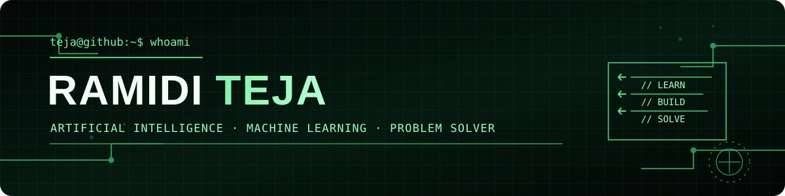
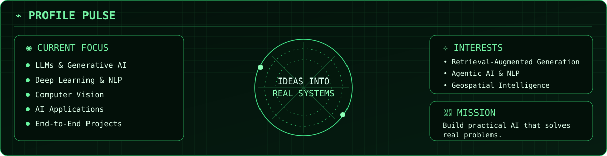
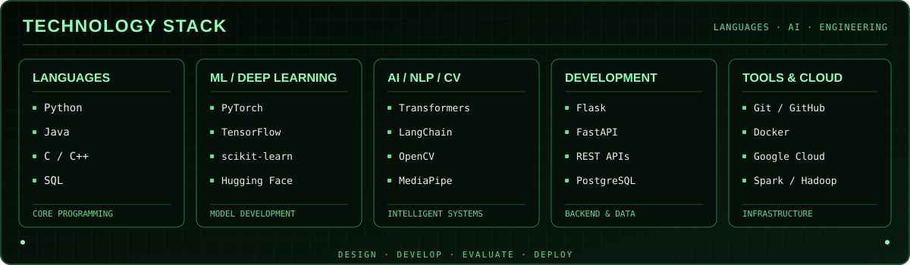

 

 

<h2>⚡ Profile Pulse</h2>

<h1>🧬 About Me</h1>

I'm a final-year Artificial Intelligence undergraduate interested in developing practical machine-learning systems and software applications.

I enjoy taking projects from data preparation and model development through API integration and application deployment, with a focus on building systems that address real-world problems.

<h1>🚀 Featured Projects</h1>

<table>
<tr>
<td width="50%" valign="top">

<h2 align="center">🧠 EchoMind</h2>

<strong>Emotion-Aware Journal Analysis</strong>

A multilingual emotion-analysis system combining text and speech across four languages. It uses journal history and retrieval-augmented generation (RAG) to provide context-aware reflections and personalized recommendations.

**Technologies**

`Python` `XLM-RoBERTa` `Hugging Face` `LangChain` `Groq API` `RAG`

 

  

</td>
<td width="50%" valign="top">

<h2 align="center">🌡️ Urban Heat Island</h2>

<strong>Detection &amp; Prediction</strong>

Analyses 25 years of NASA satellite temperature data using distributed processing, machine-learning forecasting, and geospatial visualisation to explore urban temperature patterns.

**Technologies**

`Python` `PySpark` `Spark MLlib` `Streamlit` `Google Earth Engine`

 

  

</td>
</tr>
<tr>
<td width="50%" valign="top">

<h2 align="center">🤟 Sign Language Translation</h2>

<strong>Deep Learning &amp; Computer Vision</strong>

A sign-language recognition system using ResNet-18 transfer learning, region-of-interest preprocessing, and synthetic data augmentation. Supports real-time inference with OpenCV and MediaPipe and uses Grad-CAM for model visualisation.

**Technologies**

`Python` `PyTorch` `ResNet-18` `OpenCV` `MediaPipe` `Grad-CAM`

 

  

</td>
<td width="50%" valign="top">

<h2 align="center">🚁 Real-Time Drone Delivery</h2>

<strong>Intelligent Route Planning</strong>

A web-based drone-delivery simulation using RRT* path planning, map visualisation, live movement tracking, battery monitoring, and telemetry.

**Technologies**

`Python` `Flask` `RRT*` `Folium` `PostgreSQL`

 

  

</td>
</tr>
</table>

<h2>🛠 Technology Stack</h2>

<h2>🧩 LeetCode Journey</h2>

 

<h2>🕹️ Contribution Arcade</h2>

<picture>
  <source
    media="(prefers-color-scheme: dark)"
    srcset="https://raw.githubusercontent.com/Tejaramidi0118/Tejaramidi0118/output/pacman-contribution-graph-dark.svg"
  />
  <source
    media="(prefers-color-scheme: light)"
    srcset="https://raw.githubusercontent.com/Tejaramidi0118/Tejaramidi0118/output/pacman-contribution-graph.svg"
  />
  
</picture>

<h2>🌐 Connect</h2>

  

<strong>Thanks for visiting.</strong>

  

Building, experimenting, and learning through real projects.

  

